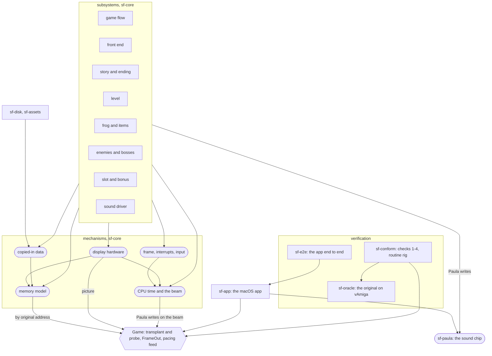

# Engine architecture

How the Rust engine in `engine/` is built, chapter by chapter. It separates the parts that imitate
the Amiga from Superfrog's own rules and from data copied in from the original, and rates each part
for reuse in another Amiga game. It is the input to a later plan that rewrites the Amiga-shaped
parts as plain native code while the game stays faithful: every chapter names behaviour to keep and
the check that proves it, never behaviour that may be dropped
(`plans/engine-architecture/DESIGN.md`).

## How to read it

Start here, then the [glossary](glossary.md), then the chapter you need. Each deep chapter has the
same sections ([chapter template](chapter-template.md)): what it is, the kind mix, the mechanisms it
uses, what depends on it, what a native rewrite must preserve with the check that proves it, a
non-binding native sketch, reuse, sources. A light chapter keeps the kind mix and reuse and replaces
the middle with where it touches the Amiga-shaped parts.

**Three tiers.** A *mechanism* chapter documents one imitation technique wherever it is used,
because the imitation is woven through the game rather than layered under it. A *subsystem* chapter
documents a part of the game and names the mechanisms it leans on. A *component* chapter is the
lighter treatment of a crate around the game.

**Four kinds.** Every chapter's `mix` splits its code into rough percentages, estimated by reading:

| Kind | Meaning |
|---|---|
| `amiga` | Imitates the Amiga's hardware or timing: memory at original addresses, cycle charging, the beam, interrupts, copper, blitter, Denise, Paula, the CIA keyboard, the disk loader |
| `game` | Superfrog's own rules: physics, enemies, scoring, flow |
| `data` | Tables, memory images and assets read from the original's disks and used as they are |
| `shell` | Neither: the macOS app, file handling, test tooling |

**The reuse scale**, judged against another Amiga game by any developer: `as-is` (no or trivial
change), `small-changes` (a few named, local changes), `big-changes` (the approach carries, much
code is rewritten), `superfrog-only` (only the method carries). Where another Team 17 game might
share more (`ATN!`, `T7MP`, Player 4.1A), a chapter says so and marks it unchecked.

**A line** is a line of code in an owned `.rs`, `.cpp`, `.h` or `.wgsl` file, tests included.
Recorded input scripts, `.toml`, patches and Markdown are counted once, separately, as uncounted.
Each tracked file under `engine/crates/` and `engine/conform/` belongs to exactly one chapter (the
`owns` prefixes in its front matter); `tools/test_architecture_docs.py` fails when one does not.

## How the parts connect

Square boxes are crates and parts of the game; rounded ones are the [mechanisms](glossary.md). An
arrow reads "leans on". The verification tooling attaches to the engine at the hexagon, `Game`'s
three doors: transplant and probe (the engine's memory by original address), `FrameOut` (the
picture, the Paula writes, the beam races, loads and jobs) and the pacing feed.

Opened up, from each subsystem chapter's "Mechanisms it uses": nearly every subsystem leans on
every mechanism, which is what "woven through, not layered under" means.

| Subsystem | Memory model | Copied-in data | Beam | Frame, interrupts | Display | Sound chip |
|---|:-:|:-:|:-:|:-:|:-:|:-:|
| [game flow](game-flow.md) | ✓ | ✓ | ✓ | ✓ | ✓ | |
| [front end](front-end.md) | ✓ | ✓ | ✓ | ✓ | ✓ | ✓ |
| [story and ending](story-and-ending.md) | ✓ own copy | ✓ | ✓ own bus simulator | ✓ own handler | ✓ | ✓ |
| [level](level.md) | ✓ | ✓ | ✓ | ✓ | ✓ | ✓ |
| [frog and items](frog-and-items.md) | ✓ | ✓ | ✓ | ✓ | ✓ | ✓ |
| [enemies and bosses](enemies-and-bosses.md) | ✓ | ✓ | ✓ | ✓ | ✓ | ✓ |
| [slot and bonus](slot-and-bonus.md) | ✓ | ✓ | ✓ and the story's simulator | ✓ | ✓ | ✓ |
| [sound driver](sound-driver.md) | ✓ | ✓ | ✓ | ✓ | | ✓ |

## Every chapter

As `python tools/architecture.py totals` printed it on 2026-10-23, on the tree with every chapter
task merged. The counts move as the code does; rerun the command for today's.

| Chapter | Tier | Kind | Mix | Reuse | Lines |
|---|---|---|---|---|---:|
| `app` | component | shell | amiga 10 game 0 data 0 shell 90 | small-changes | 10399 |
| `copied-in-data` | mechanism | data | amiga 40 game 0 data 55 shell 5 | big-changes | 0 |
| `cpu-time-and-beam` | mechanism | amiga | amiga 65 game 0 data 0 shell 35 | big-changes | 1262 |
| `disks-and-assets` | component | shell | amiga 15 game 0 data 40 shell 45 | big-changes | 6654 |
| `display-hardware` | mechanism | amiga | amiga 76 game 5 data 9 shell 10 | small-changes | 2421 |
| `enemies-and-bosses` | subsystem | game | amiga 30 game 55 data 15 shell 0 | superfrog-only | 5849 |
| `frame-interrupts-input` | mechanism | amiga | amiga 70 game 16 data 0 shell 14 | big-changes | 1098 |
| `frog-and-items` | subsystem | game | amiga 20 game 70 data 10 shell 0 | superfrog-only | 2411 |
| `front-end` | subsystem | amiga | amiga 60 game 25 data 6 shell 9 | superfrog-only | 6247 |
| `game-flow` | subsystem | shell | amiga 30 game 20 data 5 shell 45 | superfrog-only | 4845 |
| `level` | subsystem | amiga | amiga 50 game 43 data 6 shell 1 | superfrog-only | 6144 |
| `memory-model` | mechanism | amiga | amiga 80 game 5 data 15 shell 0 | big-changes | 1815 |
| `slot-and-bonus` | subsystem | game | amiga 21 game 68 data 11 shell 0 | superfrog-only | 3876 |
| `sound-chip` | mechanism | amiga | amiga 87 game 0 data 0 shell 13 | as-is | 1142 |
| `sound-driver` | subsystem | game | amiga 30 game 65 data 5 shell 0 | big-changes | 2174 |
| `story-and-ending` | subsystem | amiga | amiga 53 game 36 data 11 shell 0 | superfrog-only | 7224 |
| `verification` | component | shell | amiga 4 game 0 data 0 shell 96 | big-changes | 47779 |
| (uncounted: scripts, `.toml`, patches, Markdown) | | | | | 91969 |

`copied-in-data` owns no files: it is a view across code other chapters own and count. Each chapter
is linked under [Chapters](#chapters) below.

## The totals

111 340 lines of code, plus 91 969 uncounted lines (almost all of them recorded input scripts under
`engine/conform/scripts/`).

| Kind | Lines | Share |
|---|---:|---:|
| amiga | 25 629 | 23% |
| game | 17 114 | 15% |
| data | 6 586 | 6% |
| shell | 62 011 | 56% |

The shell share is mostly the verification tooling. Leaving verification out, the game and the app
are 63 561 lines: `amiga` 37%, `game` 27%, `shell` 25%, `data` 10%. More than a third of the engine
proper is imitating the Amiga, and it is spread through every subsystem rather than kept in one
layer.

| Reuse | Lines by chapter rating | With verification split |
|---|---:|---:|
| as-is | 1 142 | 23 483 (21%), `as-is` and `small-changes` together |
| small-changes | 12 820 | |
| big-changes | 60 782 | 17 559 (16%) |
| superfrog-only | 36 596 | 70 298 (63%) |

The first column is what `totals` prints: each chapter's lines under its one rating. It counts all
47 779 lines of [verification](verification.md) as `big-changes`, which that chapter says is not the
right figure for an estimate: by its own split, 9 521 lines carry as they are or with small changes,
4 556 need big changes and 33 702 are Superfrog's (conformance tests, route planners, sync points).
The second column uses that split.

**Against the 2026-10-15 estimate.** That estimate put about 13k of 75k lines (about 20%) as carrying
to any Amiga game; counted chapter by chapter on today's 111k lines, 23.5k (21%) carry as they are or
with small changes, a further 17.6k (16%) carry as an approach, and 70.3k (63%) are Superfrog's. The
headline share holds. What carries is mostly the verification harness (`sf-oracle`, the checks), the
app and the sound chip; the codebase has grown by about half since the estimate.

## Recommended order for the native rewrite

A recommendation drawn from the mechanism chapters' "what depends on it" and "what a native rewrite
must preserve" sections. Designing the rewrite is the later plan's job; nothing here is decided.
Faithful stays the bar throughout: each step is done while every conformance check stays green.

**0. Decide the memory-address coupling first.** The checks start the engine from the original's
memory (transplant) and read its values back by original address (probe). A native engine that keeps
values in its own types breaks both, and with them check 1, check 4's milestones, routine
conformance, bug replay and the `render` cases. The options are laid out, not chosen, in
[memory-model §8](memory-model.md) and, door by door from the checks' side, in
[verification "What a native rewrite must still provide"](verification.md): keep a mapping layer
(byte store behind typed accessors), write a probe adapter (native state projected to original
addresses, and the inverse for transplant), or change the checks (compare in native terms and lose
address-level precision). The routes can be mixed per subsystem. The app also reaches past `Game` by
original address twice (`FINDINGS.md` 2026-10-23, T16), and those need named replacements whichever
route is taken. Every later step depends on this choice, which is why it comes first.

**1. Copied-in data: decode the tables at import.** Move each table the routines read by address
(templates, frame lists, paths, pickup tables, level codes, `top_loop`) to a typed structure decoded
at import, the pattern `Tables` in `engine/crates/sf-assets/src/tables.rs` already follows, with
pointers turned into kind ids and indices; fold the four copies of hunk 0 into one
([copied-in-data §4, §5, §9](copied-in-data.md)). First because it does not depend on step 0: the
image is never compared, only read, so each table can move on its own and the checks prove it.
Every later step then reads typed data rather than addresses. Must keep: copied-in-data §8, and the
copyright boundary (tables stay read from the disks, never baked into source, §6).

**2. CPU time and the beam: take the timing out of the game rules.** Ported routines call `spend`
inline in about ten files, so a routine cannot be rewritten without deciding where its cost goes.
Turn it into a list of timed events (Paula writes, display writes) whose times come from a cost
table beside the routine, and merge the four separate beam models (level `Clock`, front end `Cx`,
slot draw, story simulator) where they can share one clock
([cpu-time-and-beam §6](cpu-time-and-beam.md)). Before the subsystems because every subsystem
rewritten afterwards must still emit timed writes. Must keep: a beam position on every Paula write
(notes are otherwise lost, T213), on every display write that can race the beam, and frames ending
mid-pass where the original's did in conformance ([cpu-time-and-beam §5](cpu-time-and-beam.md)).

**3. The frame, interrupts and input: two explicit schedulers.** A per-frame step (the vertical
blank's work, in its order) and a per-pass step (the 25 Hz pass), behind an explicit frame boundary,
with a "where in the frame" value replacing cycle-charged cut points, and the keyboard as an adapter
that keeps the CIA's poll-every-second-blank behaviour; the two `kbd_poll` copies become one
([frame-interrupts-input §6](frame-interrupts-input.md)). After step 2 because the cut points come
from the beam. Must keep: frog every frame and objects every second frame, late passes as conformance
feeds them, pause and ESC timing ([frame-interrupts-input §5](frame-interrupts-input.md)).

**4. The subsystems, one at a time, onto native state.** With typed data, timed events and explicit
schedulers, each subsystem can move its state off the byte store through the route chosen in
step 0, while the others stay on it ([memory-model §10](memory-model.md)). Each chapter's §5 lists
what to keep and its §6 sketches a shape: [frog and items](frog-and-items.md),
[enemies and bosses](enemies-and-bosses.md), [the level](level.md),
[the slot machine and the bonus level](slot-and-bonus.md), [the sound driver](sound-driver.md),
[the front end](front-end.md), [game flow](game-flow.md). The repeated ports the chapters found (the
blitter three times, the keyboard poll twice, darts and swings twice, the slot's second lamp drawer)
are merged here. The [story and the ending](story-and-ending.md) comes last of the subsystems: its
draws race the beam to the cycle on its own bus simulator, the finest timing in the engine.

**5. The display hardware: keep the picture contract, rewrite last.** `Picture` (indices, a palette
per line, mid-line splits in display-window coordinates) is already what the checks compare, and
two thirds of the renderer is generic OCS imitation rated `small-changes`. The smallest step keeps
the display memory and replaces the cycle-by-cycle copper run with a precomputed schedule; a full
scene-description renderer needs step 0 settled, because the exact `render` compare transplants
memory, and needs a "what the beam had seen by this line" input or late redraws fail check 2
([display-hardware §4, §6](display-hardware.md)).

**Keep: the sound chip.** `sf-paula` is already the native shape of what it imitates, a clock-stepped
model behind `PaulaWrite` in and samples out, rated `as-is`. A rewritten sound driver can keep
emitting register writes into it; one that stops would lose the per-channel equality with the
original and need a new proof of the retrigger behaviour ([sound-chip §7](sound-chip.md)).

**Keep: verification.** It is the acceptance test of every step above, not something to rewrite;
what it needs from the engine is step 0.

## Open questions the chapters left

Each is stated in its chapter with how to find out; none was guessed.

Timing and the beam:

- Whether coarser cost kinds would keep the cost model's 70%/98% bands, and whether any check needs
  each blit word's write position ([cpu-time-and-beam §6](cpu-time-and-beam.md)).
- How many picture frames depend on display writes carrying a beam position, measurable by zeroing
  the costs ([cpu-time-and-beam §5](cpu-time-and-beam.md)).
- Whether yielding the pass only at phase boundaries would still pass the stepped level cases
  ([level §6](level.md)).
- Whether the frame-boundary cut points can leave normal play; tied to the coupling
  ([frame-interrupts-input §6](frame-interrupts-input.md)).
- Whether the story's `sfx_play`, which makes all its writes at one instant, is audible; its
  handler's own length goes untested because conformance feeds the original's
  ([story-and-ending §5](story-and-ending.md)).
- Whether the app's mixing every frame as 313 lines, ignoring short frames, is audible or visible
  ([sound-chip §6](sound-chip.md), [app](app.md)).

The verification coupling:

- Whether checks 2–4 alone would catch what check 1 catches, measurable by planting divergences
  ([verification](verification.md)).
- Whether a native renderer's lack of beam races would fail check 2's budget on frames the original
  raced ([verification](verification.md)).
- Check 4 is not address-free: the milestones read 13 variables by address and name the screen by
  copper list address (`FINDINGS.md` 2026-10-23, T17; [verification](verification.md)).

Behaviour no check reaches:

- The null-pointer reads at 0 and 4 and the write to `$64` ([memory-model §9](memory-model.md),
  [enemies-and-bosses §5](enemies-and-bosses.md)).
- The mouse moving (`JOY0DAT` never changes in any script)
  ([frame-interrupts-input §5](frame-interrupts-input.md)).
- The attract demo played unpaced, as in normal play ([front-end §1](front-end.md)).
- The slot's free spin and other rare slot paths ([slot-and-bonus §5](slot-and-bonus.md)).
- A zero instrument pointer in the sound driver ([sound-driver §5](sound-driver.md)), whether any
  tune reads past a replayer table's end ([copied-in-data §8](copied-in-data.md)), and ADKCON attach
  modes ([sound-chip §6](sound-chip.md)).
- `SoundData::from_game`, the app's path, against `from_disks`, the tests'
  ([disks-and-assets](disks-and-assets.md)).

Decisions for the owner:

- Whether a long sequence such as `top_loop` written out as code still counts as a fact under the
  copyright boundary ([copied-in-data §6](copied-in-data.md)).
- Whether the app never starting the story intro is intended ([story-and-ending](story-and-ending.md);
  `FINDINGS.md` 2026-10-23, T10).

One known slip, left because chapter bodies are frozen: copied-in-data §8's row for the world files
says `hero_frames` is compared by every level case; it is a `presentation` variable, left out of the
state check, as [front-end §5](front-end.md) states correctly.

## Chapters

Mechanisms: [memory model](memory-model.md), [copied-in data](copied-in-data.md),
[CPU time and the beam](cpu-time-and-beam.md),
[the frame, interrupts and input](frame-interrupts-input.md),
[the display hardware](display-hardware.md), [the sound chip](sound-chip.md).

Subsystems: [the sound driver](sound-driver.md), [game flow](game-flow.md),
[the front end](front-end.md), [the story and the ending](story-and-ending.md),
[the level](level.md), [the frog and the items](frog-and-items.md),
[enemies and bosses](enemies-and-bosses.md), [the slot machine and the bonus level](slot-and-bonus.md).

Components: [disks and assets](disks-and-assets.md), [the app](app.md),
[verification](verification.md).
